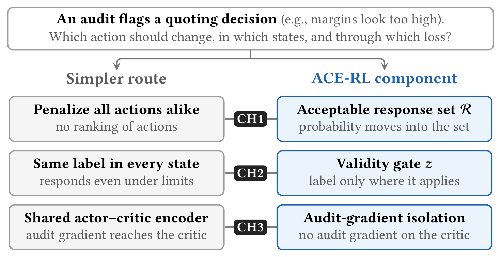
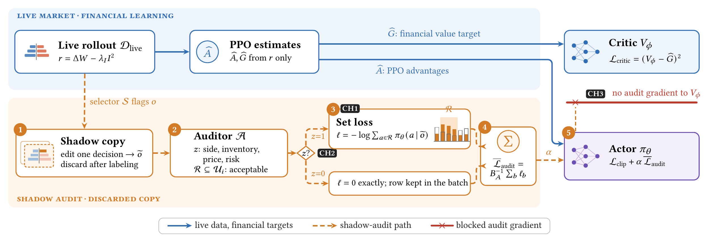
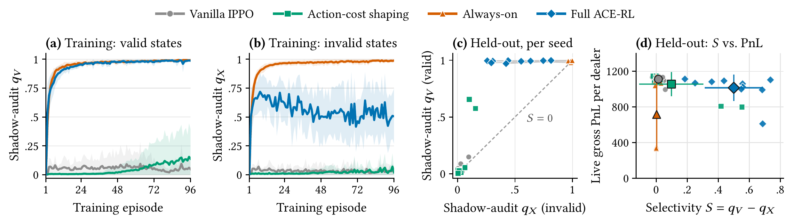
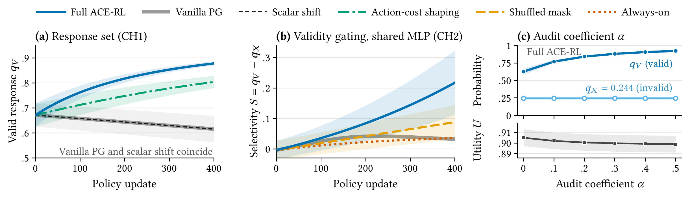
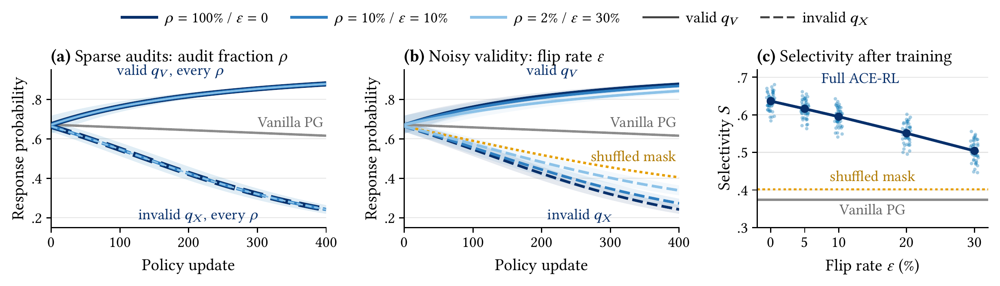

<p align="center">
  <picture>
    <source media="(prefers-color-scheme: dark)" srcset="assets/logo-dark.png">
    
  </picture>
</p>

<h1 align="center">ACE-RL: Counterfactual Audit Signals for Policy-Level Governance of Autonomous Market Makers</h1>

<p align="center">
  <a href="https://doi.org/10.1145/3858063.3858910"></a>
  <a href="https://icaif2026.org/"></a>
  
  <a href="#-quick-start"></a>
  <a href="https://github.com/moderncavemann/ACE-RL-submission/stargazers"></a>
  <a href="https://github.com/moderncavemann/ACE-RL-submission/forks"></a>
  <a href="https://hitscounter.dev/history?url=https%3A%2F%2Fgithub.com%2Fmoderncavemann%2FACE-RL-submission"></a>
</p>

<p align="center">
  <a href="README.md"><strong>English</strong></a> | <a href="README.zh-CN.md">简体中文</a>
</p>

> **Authors:** Guanghao Wu<sup>\*</sup>, Zhuo Cai<sup>\*</sup>, Shoujin Wang<sup>†</sup><br>
> University of Technology Sydney<br>
> <sup>\*</sup>Equal contribution &nbsp; <sup>†</sup>Corresponding author

ACE-RL (Audit-Conditioned Enforcement for Reinforcement Learning) **turns an audit of an autonomous market maker into a policy update** during training. For each selected state, an auditor edits a shadow copy, leaving the live market untouched, and returns an audit tuple: the edited observation, a validity flag stating whether a response is admissible in that state, and a set of acceptable responses. A validity-gated set loss trains the actor on this tuple, while the critic learns only from financial returns.

- 🔍 **Counterfactual shadow audit:** evaluates a discarded copy of the selected state and returns the set of acceptable responses, without changing the live market.
- 🚦 **Validity gate:** applies the audit label only where a response is admissible, and gives an exact zero loss elsewhere.
- 🧱 **Audit-gradient isolation:** trains the actor on the label, while no audit gradient reaches the critic.

## 🧭 Why ACE-RL?

Reinforcement learning can automate market making, but independently trained market makers may, like pricing algorithms, drift into high-margin behavior without explicit agreement. An audit can flag such behavior, but it does not tell the learner which action to change, in which states, or through which loss. An observer sees only quotes, trades, spreads or margins, not the reason behind an action, and the same action can mean different things in different states: declining to tighten a quote may preserve a high margin, or it may respond to an inventory limit, an unfavorable price or excessive risk.

<p align="center">
  
</p>

<p align="center"><sub>Three challenges in turning an audit into a policy update. Each row pairs a simpler route (left) with the ACE-RL component for that challenge (right).</sub></p>

### 🎯 Three Challenges

- **CH1: Action specificity.** The learner must know which actions count as an acceptable response. Outcome statistics give aggregate pressure, not a ranking of actions, and a penalty shared by all states and actions cancels in the advantage once the critic adapts.
- **CH2: Contextual validity.** An audit label applies only in some states, which we call valid. In an invalid state, a response would be inappropriate, for example because of an inventory or risk limit. Applying the label everywhere pushes the agent to respond even there.
- **CH3: Objective separation.** The label should change the policy, not what the critic estimates. Adding it to the reward mixes governance pressure into the value target, and even an actor-only loss can reach critic features through a shared encoder.

## ⚙️ How It Works

ACE-RL routes information by the question it answers. Live experience answers "what produced financial return?" and supplies the usual PPO advantages and value targets. A shadow audit answers "in this selected state, is a response admissible, and which actions count as one?" and supplies a label for the actor only.

<p align="center">
  
</p>

<p align="center"><sub>Live financial learning (top) trains both networks; the shadow audit (bottom) reaches only the actor. The numbers mark the five steps below.</sub></p>

1. **Shadow copy.** A selector flags a live observation, and the auditor edits one decision on a copy of it. The copy only queries the policy and is discarded after labeling: live orders, fills, inventory and rewards are unchanged.
2. **Audit.** The auditor checks side, inventory, price and risk, and returns the audit tuple (õ, z, R): the edited observation õ, a validity flag z, and the set R of acceptable responses.
3. **Set loss.** Valid rows (z = 1) receive the loss −log Σ<sub>a∈R</sub> π<sub>θ</sub>(a | õ), which moves probability into the whole set without prescribing a single member. Invalid rows (z = 0) receive an exact zero and stay in the batch.
4. **Average.** The loss is averaged over all audited rows, so the coefficient α sets the strength of the label and z decides whether it applies.
5. **Actor update.** The actor minimizes the PPO clip loss plus α times the audit loss. The critic keeps only its financial value loss, and disjoint parameters or a stop-gradient ensure that no audit gradient reaches it.

With no audited state, the update reduces to ordinary PPO, and the auditor is needed only during training. The audit tuple, the set loss and the isolated IPPO update of the ten-dealer market are in [`revision/src/agents/typed_audit.py`](revision/src/agents/typed_audit.py). Three checks make the update testable, and the unit tests run them: an audit-only step on a valid tuple raises the probability of R (*direction*); with every z = 0, the audit gradient vanishes (*gating*); and an audit-only step leaves every parameter that the critic uses unchanged (*isolation*).

## 📊 Results

### 📈 Ten-Dealer Market

In an ABIDES-based market, ten dealers each choose one of seven half-spreads, from one to seven ticks, and one recurrent IPPO actor with shared parameters controls all ten. For each of ten policy seeds, four methods start from the same checkpoint and train for the same budget: Vanilla IPPO; action-cost shaping, which subtracts a fixed cost from the reward whenever a dealer in a valid state quotes outside the response set; Always-on, which applies the set loss in every audited state; and Full ACE-RL (Full). Every dealer step is audited. The shadow edit sets the dealer's previous quote to a three-tick half-spread and asks whether the dealer would keep quoting within one to three ticks; a state is valid when public volatility is at most one tick and absolute inventory is at most 20 units.

<table>
  <thead>
    <tr>
      <th align="left">Method</th>
      <th align="center">q<sub>V</sub> ↑</th>
      <th align="center">q<sub>X</sub> ↓</th>
      <th align="center">S ↑</th>
      <th align="center">Gross PnL ↑</th>
      <th align="center">Half-spread</th>
      <th align="center">Agreement</th>
      <th align="center">Entropy</th>
    </tr>
  </thead>
  <tbody>
    <tr><td>Vanilla IPPO</td><td align="center">0.040<br><sub>±0.047</sub></td><td align="center"><b>0.026</b><br><sub>±0.033</sub></td><td align="center">0.014<br><sub>±0.027</sub></td><td align="center"><b>1111.1</b><br><sub>±47.4</sub></td><td align="center">6.80<br><sub>±0.24</sub></td><td align="center">0.831<br><sub>±0.152</sub></td><td align="center">0.264<br><sub>±0.240</sub></td></tr>
    <tr><td>Action-cost shaping</td><td align="center">0.136<br><sub>±0.254</sub></td><td align="center">0.038<br><sub>±0.054</sub></td><td align="center">0.098<br><sub>±0.207</sub></td><td align="center">1055.2<br><sub>±136.4</sub></td><td align="center">6.52<br><sub>±0.68</sub></td><td align="center">0.811<br><sub>±0.126</sub></td><td align="center">0.293<br><sub>±0.199</sub></td></tr>
    <tr><td>Always-on</td><td align="center"><b>0.992</b><br><sub>±0.007</sub></td><td align="center">0.990<br><sub>±0.011</sub></td><td align="center">0.003<br><sub>±0.011</sub></td><td align="center">715.1<br><sub>±392.5</sub></td><td align="center">4.82<br><sub>±1.97</sub></td><td align="center">0.896<br><sub>±0.059</sub></td><td align="center">0.161<br><sub>±0.092</sub></td></tr>
    <tr><td><b>Full ACE-RL (ours)</b></td><td align="center">0.989<br><sub>±0.009</sub></td><td align="center">0.490<br><sub>±0.192</sub></td><td align="center"><b>0.500</b><br><sub>±0.188</sub></td><td align="center">1014.3<br><sub>±147.9</sub></td><td align="center">6.31<br><sub>±0.74</sub></td><td align="center">0.786<br><sub>±0.100</sub></td><td align="center">0.335<br><sub>±0.150</sub></td></tr>
    <tr><td colspan="8"><i>Paired difference across seeds</i></td></tr>
    <tr><td>Full − Always-on</td><td align="center">−0.003<br><sub>±0.013</sub></td><td align="center">−0.500<br><sub>±0.199</sub></td><td align="center">+0.497<br><sub>±0.194</sub></td><td align="center">+299.1<br><sub>±364.0</sub></td><td align="center">+1.49<br><sub>±1.82</sub></td><td align="center">−0.110<br><sub>±0.090</sub></td><td align="center">+0.174<br><sub>±0.138</sub></td></tr>
    <tr><td>Full − Vanilla</td><td align="center">+0.950<br><sub>±0.048</sub></td><td align="center">+0.464<br><sub>±0.192</sub></td><td align="center">+0.486<br><sub>±0.193</sub></td><td align="center">−96.8<br><sub>±165.1</sub></td><td align="center">−0.48<br><sub>±0.83</sub></td><td align="center">−0.046<br><sub>±0.174</sub></td><td align="center">+0.071<br><sub>±0.271</sub></td></tr>
  </tbody>
</table>

<p align="center"><sub>Mean ± SD over 10 policy seeds, each evaluated on 20 held-out order-flow paths; in the paired rows, ± is the SD of the per-seed difference. q<sub>V</sub> and q<sub>X</sub> are shadow-audit response probabilities, the probability that the policy assigns to the one- to three-tick half-spreads on the shadow observation, in valid and invalid states; S = q<sub>V</sub> − q<sub>X</sub> is the selectivity. They describe responses to the audit, not frequencies of live quotes. The other columns come from the live market: gross PnL per dealer over 100 steps before the inventory penalty, quoted half-spread in ticks, and pairwise agreement and entropy of dealer actions. <b>Bold</b>: best in each column with a preferred direction (arrow).</sub></p>

Full and Always-on share the set loss and its coefficient and differ only in which states receive the loss. On the shadow audits, both almost always respond in valid states, but Full roughly halves the response in invalid states, so its selectivity rises from near zero to about 0.5 and is higher in all ten seeds. Because gating also reduces supervision from all audited states to the 46% that are valid, this comparison measures the overall effect of gating; the controlled experiments below separate where the labels apply from how many there are. In the live market, Always-on quotes the narrowest spreads, whereas Full earns more gross PnL on average (higher in seven of ten seeds).

Against Vanilla IPPO, Full raises selectivity in all ten seeds and earns about 9% less gross PnL on average. Its PnL is lower in nine of ten seeds, but the paired difference varies widely across seeds, so ten seeds do not determine the size of the loss precisely. This is a selectivity–PnL trade-off rather than uniform dominance. Selectivity also measures separation, not suppression: in invalid states, Full's shadow-audit response stays near one half, whereas Vanilla IPPO's stays near zero.

<p align="center">
  <a href="assets/tendealer.png"></a>
</p>

<p align="center"><sub><strong>(a, b)</strong> Shadow-audit response in valid and invalid states on the recorded training rollouts (mean ± 1 SD over 10 seeds). <strong>(c)</strong> Held-out response per seed; the dashed diagonal marks zero selectivity, and gray segments link each seed's Always-on and Full policies. <strong>(d)</strong> Held-out selectivity and live gross PnL per seed; large markers show means ± 1 SD.</sub></p>

### 🔬 Controlled Experiments

Controlled experiments isolate each challenge with endpoints computed exactly. In three contexts, the learner chooses among Hold (H), a moderate response (M) and an aggressive response (A): V is a valid competitive opportunity in which responding is plausible but slightly less profitable than holding, and I and P are blocked by inventory and by price or risk, where holding is clearly best. The audit is valid, with R = {M, A}, only in V. Within each seed, the methods share initial parameters, updates, batches and samples, and differ only in the signal they add and where it is routed: Vanilla PG (financial policy gradient only); action-cost shaping; a scalar shift, which subtracts a constant from the returns of all actions in V; a shuffled mask, which permutes the validity flags within each batch and so keeps the number of active labels; Always-on; and Full ACE-RL. The endpoints are the response probabilities q<sub>V</sub> in V and q<sub>X</sub> in I and P, the selectivity S = q<sub>V</sub> − q<sub>X</sub>, and the exact expected financial utility U.

| Contrast | Learner | Endpoint | Difference | Seeds with difference > 0 |
| --- | --- | :---: | ---: | ---: |
| C1: Full − scalar shift | independent logits | q<sub>V</sub> | 0.263 ± 0.044 | 50/50 |
| C3: Shuffled mask − Full | independent logits | q<sub>X</sub> | 0.163 ± 0.005 | 50/50 |
| S3: Full − shuffled mask | shared MLP | S | 0.130 ± 0.051 | 100/100 |
| S4: Full − shuffled mask | shared MLP | U | 0.033 ± 0.012 | 99/100 |

<p align="center"><sub>Prespecified paired contrasts: mean ± SD of the per-seed difference; two-sided one-sample t tests, Holm-corrected within each experiment's five contrasts. All four meet every prespecified pass criterion, and every Holm-adjusted p &lt; 10<sup>−38</sup>.</sub></p>

- **Response set (CH1).** With independent logits, Full ends with a valid-context response of 0.878, whereas the scalar shift leaves the policy identical to Vanilla PG's at every checkpoint, to machine precision, ending at 0.616: the audit label supplies relative action information that the scalar shift cannot. Action-cost shaping attains the highest utility and nearly Full's selectivity here, but its cost carries more information than the audit label, because it also penalizes responses in the invalid contexts, where the auditor returns no label.
- **Validity gate (CH2).** The shuffled mask receives as many active labels as Full but raises the response in invalid contexts. Under a shared MLP, where every update can affect every context, Full is more selective than the shuffled mask in all 100 seeds and attains higher utility in 99. Selectivity depends on where the labels apply, not on how many there are. Sharing also spreads valid-only updates, so Full's invalid-context response stays well above Vanilla PG's (0.35 vs. 0.08), as in the ten-dealer market.
- **Audit coefficient α.** As α grows from 0 to 0.5, the valid-context response rises monotonically, the invalid-context response stays fixed, and utility declines only slightly.
- **Critic isolation (CH3).** In all 100 seeds, an audit-only step with disjoint actor and critic encoders raises the probability of the response set and leaves every parameter and output that the critic uses unchanged; a shared encoder changes them in every seed. In all 960 Full ACE-RL updates of the ten-dealer runs, the audit gradient on the critic and the audit loss on invalid rows are exactly zero.
- **Order book.** With a price–time-priority matching engine, every acceptable quote passes the action-grid, price, non-crossing, inventory and risk checks on a shadow copy of the book; valid rows raise the probability of the response set, invalid rows give an exact-zero update, and the live book is unchanged. These checks establish feasibility in single updates, not long-run effects in a full order book.

<p align="center">
  <a href="assets/controlled.png"></a>
</p>

<p align="center"><sub><strong>(a)</strong> The audit label supplies action direction with independent logits. <strong>(b)</strong> Aligned validity gives higher selectivity under a shared MLP. <strong>(c)</strong> The valid-context response grows with α while the invalid-context response stays fixed. Means ± 1 SD over 50, 100 and 50 seeds.</sub></p>

### 🛡️ Sparse and Noisy Audits

The ten-dealer market audits every step with a correct validity rule, whereas a deployed auditor would label fewer states and make errors. We rerun the independent-logit experiment for Full ACE-RL with the released learner, seeds and budget. Auditing only 2% of the rows, about eight per update, leaves the learning curves essentially unchanged; with independent logits, q<sub>X</sub> is unaffected by construction. Validity errors instead degrade the policy gradually: as the flip rate of the validity flags rises to 30%, selectivity drops from 0.64 to 0.50, yet it stays above Vanilla PG's (0.37) in all 50 seeds at every error rate. This study was added after review and was not prespecified.

<p align="center">
  <a href="assets/robustness.png"></a>
</p>

<p align="center"><sub><strong>(a)</strong> Learning curves for audit fractions of 100%, 10% and 2% coincide. <strong>(b)</strong> Flipping validity flags slows the rise of q<sub>V</sub> and the fall of q<sub>X</sub>. <strong>(c)</strong> Final selectivity (dots: seeds) falls gradually with the flip rate but stays above the shuffled mask and Vanilla PG.</sub></p>

### 🚧 Limitations

ACE-RL complements cost-based and rule-based control rather than replacing it: given a complete, correctly specified state–action cost, action-cost shaping attains higher utility, and a shield, which removes forbidden actions, enforces hard rules directly. The ten-dealer evidence comes from one simulated market with dense audits, one validity rule, one shadow edit and short fine-tuning runs; endogenous audit selectors, longer horizons, other market regimes and other architectures remain to be tested. One shared actor controls all ten dealers, so the results do not show how ten independently parameterized learners would behave. Orders reach dealers regardless of their quotes, so all methods face the same fills and inventory paths and differences in gross PnL reflect the quoted spreads; the feedback from quotes to execution probability and inventory exposure remains untested. Because the shadow-audit response in invalid states rises relative to Vanilla IPPO, deployments should monitor live quotes in such states alongside inventory and adverse-selection measures, and can add a shield where a hard rule applies. Finally, action agreement and entropy describe how diverse joint quoting is, not intent or collusion, which require behavioral or legal analysis.

## 🧪 Experiments

| Study | Tests | Learner | Runs | Code |
| --- | --- | --- | ---: | --- |
| **Ten-dealer market** | end-to-end | recurrent IPPO, ten dealers | 10 × 4 | [`revision/`](revision/) |
| **Independent logits** | CH1, CH2 | context-specific softmaxes | 50 × 6 | [`experiments/independent_context/`](experiments/independent_context/) |
| **Shared MLP** | CH2 | 3→8→3 tanh MLP | 100 × 4 | [`experiments/shared_representation/`](experiments/shared_representation/) |
| **Coefficient grid** | CH2 | independent-logit learner | 50 × 6 | [`experiments/coefficient_sensitivity/`](experiments/coefficient_sensitivity/) |
| **Critic ablation** | CH3 | width-8 actor–critic | 100 × 2 | [`experiments/independent_context/`](experiments/independent_context/) |
| **Order book** | feasibility | seven-action logits | 100 × 3 | [`experiments/lob_contract/`](experiments/lob_contract/) |
| **Sparse, noisy audits** | robustness | independent-logit learner | 50 × 9 | [`paper/`](paper/) |

Runs are seeds × settings (methods, coefficient values, model variants, scenarios or perturbation levels). Every study except the sparse- and noisy-audit study follows a prospective protocol frozen before its formal run, and every run planned under these protocols completed.

## 🚀 Quick Start

Python 3.13 with the pinned packages in `requirements.txt`; no GPU is needed. The controlled experiments, the sparse- and noisy-audit study and the scripts for Tables 4–5 and Figures 3–5 run on a CPU; the ten-dealer market needs Docker and files that are not part of this repository (see below). Each controlled runner checks the hash of its frozen protocol, and `--verify-determinism` runs the experiment a second time in a temporary directory and checks that its core outputs are reproduced byte for byte.

```bash
git clone https://github.com/moderncavemann/ACE-RL-submission.git
cd ACE-RL-submission
python3.13 -m venv .venv && source .venv/bin/activate
python -m pip install -r requirements.txt
python revision/experiments/setup_official_on_policy.py   # clones the pinned on-policy commit for the IPPO tests
python -m pytest -q
```

Run the controlled experiments, about five minutes in total on a CPU. Two of the runners refuse to write into an existing output directory, so remove `outputs/` before running them again.

```bash
python experiments/independent_context/run_main_experiment.py --formal --verify-determinism --output-dir outputs/independent_context
python experiments/independent_context/run_critic_ablation.py --output-dir outputs/critic_isolation --verify-determinism
python experiments/shared_representation/run_experiment.py --formal --verify-determinism --output-dir outputs/shared_representation
python experiments/coefficient_sensitivity/run_experiment.py --formal --verify-determinism --output-dir outputs/coefficient_sensitivity
python experiments/lob_contract/run_experiment.py --formal --verify-determinism --output-dir outputs/lob_contract
python scripts/verify_release.py
```

[`paper/`](paper/) recomputes Tables 4–5 and Figures 3–5 of the paper from these outputs and from the formal ten-dealer outputs in the repository. The plotting scripts typeset text with LaTeX in the paper's fonts, so they need a LaTeX installation with the `libertine` and `newtx` packages.

```bash
FORMAL=revision/experiments/outputs/abides_typed_audit_ippo_v2/formal
# Tables 4 and 5
python paper/table_stats.py $FORMAL/rows.json outputs/independent_context/paired_contrasts.csv outputs/shared_representation/paired_contrasts.csv
# Figure 3
python paper/plot_tendealer.py paper/data/training_history.csv $FORMAL/rows.json outputs/fig_tendealer.pdf
# Figure 4
python paper/fig4_data_sd.py outputs/independent_context outputs/shared_representation outputs/coefficient_sensitivity outputs/fig4
python paper/plot_fig4.py outputs/fig4 outputs/fig_controlled.pdf
# Sparse and noisy audits, Figure 5
python paper/robustness.py experiments/independent_context outputs/robustness.json
python paper/plot_robustness.py outputs/robustness.json outputs/fig_robustness.pdf
```

`paper/data/` holds the data behind these figures, and the commands above reproduce its `fig4/` and `robustness.json` byte for byte. The per-episode training history of Figure 3a–b, `paper/data/training_history.csv`, was extracted with `paper/extract_training_history.py` from the per-seed logs of the formal ten-dealer run, which are not part of this repository.

The ten-dealer runner, [`revision/experiments/run_abides_typed_audit_ippo_v1.py`](revision/experiments/run_abides_typed_audit_ippo_v1.py) (protocol v2), is fail-closed. It checks the frozen config [`revision/configs/abides_typed_audit_ippo_v2.json`](revision/configs/abides_typed_audit_ippo_v2.json) and its protocol, the Docker image ID, the official IPPO commit and the SHA-256 of every base checkpoint, and a formal run (`--formal`) requires a completed engineering smoke (`--engineering-smoke`) and a clean, committed worktree. The pinned ABIDES image, which needs Docker with `linux/amd64` support, and the ten base checkpoints are not part of this repository. The repository instead includes the formal outputs used in the paper, in [`revision/experiments/outputs/abides_typed_audit_ippo_v2/formal/`](revision/experiments/outputs/abides_typed_audit_ippo_v2/formal/), so Table 4 is recomputed from them without Docker; because this folder is the output location named in the config, a fresh formal run must start from a commit without it.

## 🗂️ Repository Layout

| Path | Purpose |
| --- | --- |
| [`experiments/independent_context/`](experiments/independent_context/) | Independent-logit experiment (CH1, CH2) and critic ablation (CH3): frozen protocol, runners and tests. |
| [`experiments/shared_representation/`](experiments/shared_representation/) | Shared-MLP experiment (CH2). |
| [`experiments/coefficient_sensitivity/`](experiments/coefficient_sensitivity/) | Coefficient grid for α. |
| [`experiments/lob_contract/`](experiments/lob_contract/) | Order-book checks under price–time priority. |
| [`ace_rl_project/`](ace_rl_project/) | Limit-order-book matching engine used by the order-book checks. |
| [`revision/`](revision/) | Ten-dealer market: audit tuple and IPPO update (`src/`), runner and setup (`experiments/`), frozen config and protocol, tests, and the formal outputs. |
| [`paper/`](paper/) | Scripts and data for Tables 4–5 and Figures 3–5, including the sparse- and noisy-audit study. |
| [`scripts/`](scripts/) | `verify_release.py`: release checks of the file set, links and recorded formal results. |
| [`assets/`](assets/) | Logo and figures of this README. |

## 📚 Documentation

- Paper: Proceedings of the 7th ACM International Conference on AI in Finance (ICAIF '26), Milan, Italy; DOI [10.1145/3858063.3858910](https://doi.org/10.1145/3858063.3858910).
- Frozen protocols: `PROTOCOL.md` in each folder under [`experiments/`](experiments/), and [`revision/notes/abides_typed_audit_ippo_v2_protocol.md`](revision/notes/abides_typed_audit_ippo_v2_protocol.md) for the ten-dealer market. Each states the design, endpoints and prespecified checks of its experiment.

## 🖋 Citation

If this repository is useful for you, please cite as:

```bibtex
@inproceedings{wu2026acerl,
      title={{ACE-RL}: Counterfactual Audit Signals for Policy-Level Governance of Autonomous Market Makers},
      author={Guanghao Wu and Zhuo Cai and Shoujin Wang},
      booktitle={Proceedings of the 7th ACM International Conference on AI in Finance},
      series={ICAIF '26},
      year={2026},
      location={Milan, Italy},
      publisher={Association for Computing Machinery},
      address={New York, NY, USA},
      doi={10.1145/3858063.3858910},
      url={https://doi.org/10.1145/3858063.3858910},
}
```

If you have any questions, please open an issue.
